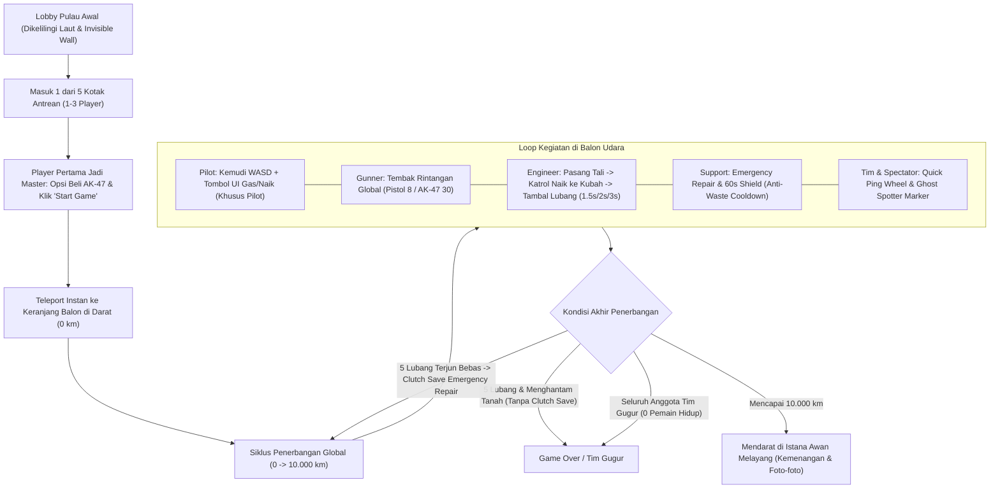
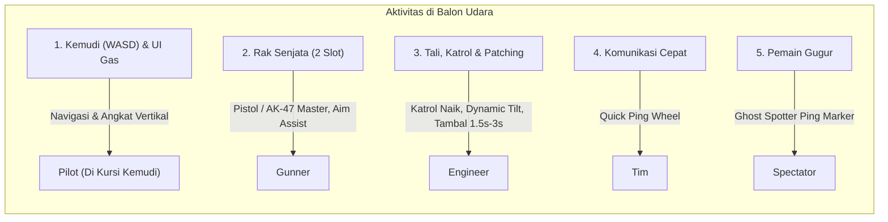
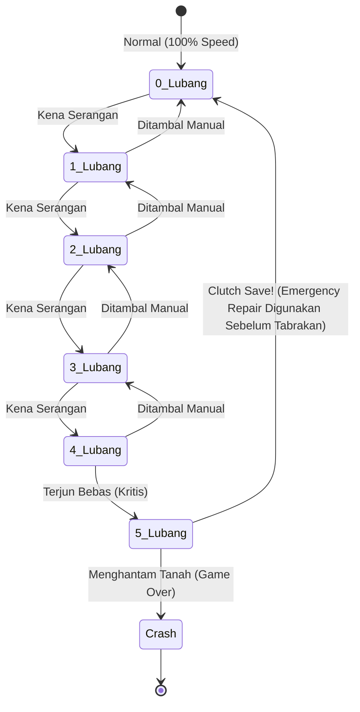
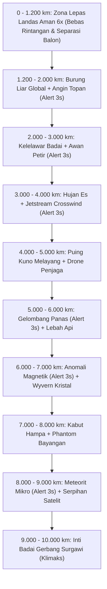
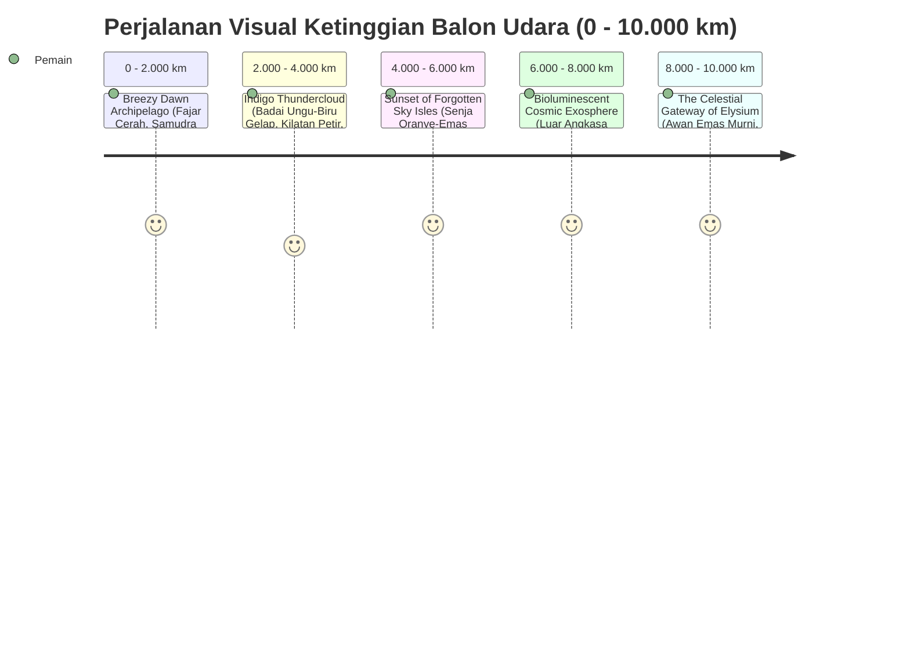

# Product Requirement Document (PRD)
# Game Roblox: "Fly High"

---

## 1. Ringkasan Eksekutif & Identitas Game

| Properti | Detail |
| :--- | :--- |
| **Judul Game** | **Fly High** |
| **Platform** | Roblox (PC, Mobile, Tablet, Console) |
| **Genre** | Co-op Survival / Vertical Flight Adventure / Party Simulation |
| **Kapasitas Pemain** | 1 - 3 Player per Balon (Multi-tim dalam 1 Server Global) |
| **Durasi Sesi Ideal** | ~10 Menit (Base ascent tanpa hambatan dari 0 km hingga 10.000 km) |
| **Target Audience** | Komunitas casual-to-midcore Roblox, pemain pecinta kerja sama kelompok (*teamwork*), simulasi petualangan, dan *scenic aesthetic games*. |
| **Core Hook (USP)** | Pengalaman kooperatif di satu ruang udara global (*shared sky*) di mana tim 1–3 pemain dapat melihat balon tim lain sambil membagi tugas secara dinamis (mengemudi via WASD & tombol gas khusus Pilot, menembak ancaman dengan aim-assist, menambal balon menggunakan katrol & tali berdurabilitas, serta fitur *Ghost Spotter*) di dalam keranjang balon yang 2x lipat lebih lapang dan Safe Takeoff Zone 6x lipat lebih luas (0 - 1.200 km) demi mencapai Istana Awan di ketinggian 10.000 km tanpa tabrakan. |

---

## 2. Alur Permainan Utama (Core Game Loop)



---

## 3. Sistem Profil Pemain & Overhead UI

Di atas kepala setiap karakter pemain terdapat `BillboardGui` dinamis yang menampilkan status pencapaian pemain sebagai simbol reputasi dan kebanggaan:

```
      [⭐ Puncak: 5x]   <--- Jika sudah pernah menamatkan game
            ATAU
     [Rekor: 7.420 km]  <--- Jika belum pernah mencapai 10.000 km
      [DisplayName (@Username)]
```

### Logika Tampilan Overhead:
1. **Pemain Belum Pernah Mencapai 10.000 km:**
   * Ditampilkan rekor ketinggian terjauh yang pernah dicapai: `[Rekor: {MaxAltitude} km]`.
   * Contoh: `[Rekor: 4.850 km]` di atas Display Name.
2. **Pemain Sudah Pernah Mencapai Puncak (10.000 km):**
   * Format teks otomatis beralih menampilkan total kemenangan: `[⭐ Puncak: {SummitCount}x]`.
   * Contoh: `[⭐ Puncak: 3x]` menandakan pemain telah berhasil mencapai Istana Awan sebanyak 3 kali.
3. **Penyimpanan Data (DataStore):**
   * Data `MaxAltitude`, `SummitCount`, dan stok `EmergencyKits` tersimpan permanen di server per `UserId` pemain.

---

## 4. Tata Ruang Dunia, Lobby, & Matchmaking

### 4.1 Pulau Awal, Lautan, & Batas Koridor Udara (*World Boundaries*)
* **Pulau Awal Kompak:** Pulau keberangkatan memiliki ukuran yang pas dan tidak terlalu luas (radius ~150 stud dari titik pusat `X=0, Z=0`), sehingga seluruh aktivitas pemain terpusat dan terlihat ramai.
* **Hamparan Laut Biru:** Area di luar batas pulau awal merupakan lautan biru luas (*Ocean*) yang memberikan kontras visual indah saat balon mulai naik ke angkasa.
* **Vegetasi & Kehidupan Pulau:** Pulau dihiasi pohon berbatang bercabang, palem, pakis, tanaman kecil, bunga, batu berfaset dan kerikil pesisir dengan bentuk organik bergaya low-poly. Ayam berkeliaran, berhenti dan mematuk; kupu-kupu terbang serta mengepakkan sayap di sekitar tanaman. Bentuk dekorasi harus terbaca jelas sebagai objek alaminya, bukan sekadar kumpulan kotak atau bola. Jalur spawn, antrean dan area lepas landas tetap lapang.
* **Invisible Wall Silinder Vertikal (Flight Corridor):**
  * Di sekeliling batas tepi pulau awal dipasang **Invisible Wall (Dinding Pembatas Tak Terlihat)** berbentuk silinder/kotak vertikal dengan radius ~150 stud yang menjulang dari permukaan tanah (`0 km`) lurus hingga ke Istana Awan (`10.000 km`).
  * Fungsi di Darat: Mencegah pemain jatuh atau berenang keluar dari pulau awal.
  * Fungsi di Udara: Menjaga seluruh balon udara tetap berada di dalam kolom jalur terbang utama menuju Istana Awan sehingga tidak bisa melenceng keluar peta.
* **Ruang Udara Bersama (*Shared Global Airspace*) & Safe Takeoff Zone 6x Lipat:**
  * Seluruh tim yang lepas landas terbang di dalam kolom udara global yang sama.
  * Tim yang sedang terbang **dapat melihat balon udara milik tim lain** yang sedang naik di bawah, di samping, atau di atas mereka, menciptakan suasana kompetitif dan sosial yang hidup.
  * **Pencegahan Tabrakan Balon (Collision Prevention):** Karena multi-balon dapat terbang bersamaan dalam satu ruang udara pandang, **Safe Takeoff Zone diralat dan diperluas menjadi 6x lipat (ketinggian 0 s.d. 1.200 km)**. Zona bebas rintangan ini memberi waktu transisi (~72 detik pertama) untuk menyebar dan mengatur jarak. Tabrakan antarbalon dan tembakan ke balon sendiri tetap menghasilkan kerusakan mulai 0 km; pemeriksaan okupansi dermaga mencegah summon yang overlap.

### 4.2 Kotak Antrean (5 Launch Pods)
* Terdapat **5 zona kotak fisik** (*Kotak A, Kotak B, Kotak C, Kotak D, Kotak E*) yang ditata membentuk busur (*arc*) di pulau awal.
* **Kapasitas per Kotak:** Maksimal **3 pemain**.
* **Role Master:**
  * Pemain pertama yang masuk ke dalam kotak otomatis diangkat menjadi **Party Master / Game Master** (ditandai ikon mahkota `👑` di atas kepala).
  * **Hak Khusus Master:**
    1. Mengakses tombol interaksi `[Mulai Penerbangan]`.
    2. Menentukan pembelian/penyediaan upgrade senjata **AK-47** untuk balon timnya.
  * Master dapat memulai penerbangan kapan saja (1, 2, atau 3 pemain).
  * Jika Master keluar dari kotak sebelum mulai, jabatan Master otomatis dialihkan ke pemain urutan berikutnya di dalam kotak.
* **Transisi Mulai Instan (*Instant Boarding*):**
  * Begitu Master menekan tombol `Mulai Penerbangan`, seluruh pemain di dalam kotak **seketika diteleportasikan ke dalam keranjang balon udara** yang berada di landasan darat pulau (`0 km`) tanpa waktu tunggu lama di luar.

---

## 5. Mekanika Balon Udara & Pembagian Peran

Balon udara terdiri dari 3 bagian utama:
1. **Gondola / Keranjang (Diperluas 2x Lipat):**
   * **Ukuran Lapang 2x Lipat:** Lantai keranjang dirancang **2x lipat lebih luas** (luas ruang berjalan diperlebar dari versi sebelumnya yang sempit), memberikan kenyamanan maksimal bagi 1–3 pemain untuk berlalu-lalang, membidik musuh, dan berkoordinasi tanpa saling menabrak atau terhalang.
   * **Fasilitas Lengkap di Keranjang:** Berisi kemudi fisik (*HelmSeat*) di haluan depan, 2 rak senjata di dinding samping yang mudah dijangkau, stasiun tali pengaman & katrol winch menuju kubah di bagian buritan, pagar pengaman (*railing*) kokoh sekeliling gondola, serta lampu sirine peringatan bahaya di tiang utama.
2. **Burner (Tungku Api Gas):** Terletak di tengah atas keranjang yang luas untuk memanaskan udara dan mengangkat balon secara vertikal.
3. **Envelope (Kain Balon):** Bagian kubah balon udara raksasa tempat munculnya titik-titik robekan/lubang, dilengkapi titian jalan (*Envelope Walkway*) melingkar di sekeliling kubah untuk akses perbaikan tali.



### 5.1 Aktivitas 1: Mengontrol Balon Udara (Navigation & Flight)
* **Skema Kontrol Khusus Pilot:**
  * Pemain duduk/berinteraksi pada kursi kemudi (*Helm*) di bagian depan gondola untuk menjadi **Pilot**. Kursi kemudi tidak terkunci permanen; siapa pun yang masih hidup bisa bergantian mengambil alih kemudi kapan saja.
  * **Gerakan Horizontal (Maju, Mundur, Kiri, Kanan):** Menggunakan tombol **WASD** (atau Dynamic Thumbstick di mobile) selama dibatasi oleh *Invisible Wall* koridor terbang.
  * **Gerakan Naik (Ascend) — Eksklusif Pilot:**
    * Tombol UI **`[ 🔥 GAS / NAIK ]`** **HANYA muncul di layar pemain yang sedang memegang kemudi (Pilot)**.
    * Ketika Pilot menahan tombol tersebut, tungku burner menyemburkan api besar, kain balon mengembang, dan balon memperoleh gaya angkat vertikal.
    * Ketika Pilot turun dari kursi kemudi, tombol `[ 🔥 GAS / NAIK ]` otomatis disembunyikan dari layarnya agar tidak memenuhi layar atau berkonflik dengan peran Gunner/Engineer.
  * **Gerakan Turun (Descend):** Tombol UI Gas dilepas (atau tidak ada Pilot di kemudi). Api burner mengecil dan balon turun perlahan sesuai status kerusakan lubang (namun tidak akan menembus tanah saat berada di ketinggian 0 km).
* **Fisika Kemiringan Dinamis (*Dynamic Weight & Tilt*):**
  * Ketika ada Engineer yang memanjat ke kubah balon di sisi tertentu, keranjang dan balon akan **sedikit miring (*tilt/lean*) ke arah sisi posisi pemain tersebut**, memberikan umpan balik fisika yang imersif.

---

### 5.2 Aktivitas 2: Menembak Objek Perusak (Defense & Combat)
* **Ketersediaan Senjata di Balon:**
  * Disediakan **2 slot senjata** di rak gondola.
  * Sistem *pickup* (`[E]`) dan *drop* (`[G]`). Tidak ada backpack inventory.
  * **Unlimited Reserve Ammo:** Seluruh senjata memiliki cadangan peluru tak terbatas; pemain cukup melakukan *reload* saat magazine habis.
* **Spesifikasi Senjata:**
  | Tipe Senjata | Kapasitas Mag | Sistem Tembak | Cadangan | Ketentuan |
  | :--- | :---: | :---: | :---: | :--- |
  | **Pistol Biasa (Handgun)** | **8 Peluru** | Semi-otomatis (Reload 1.5s) | **Tak Terbatas** | Default gratis di balon (2 unit) |
  | **AK-47 (Tactical Rifle)** | **30 Peluru** | Otomatis cepat (Reload 2.0s) | **Tak Terbatas** | **Hanya dapat dibeli/disediakan oleh Game Master** (Maksimal 2 unit) |

* **Sistem Ergonomi & Auto-Aim (Khusus Mobile/Opsional):**
  * **Auto-Aim Target Soft-Lock:** Kamera / bidikan pemain di perangkat mobile dapat mengunci secara halus ke arah rintangan terbang terdekat di layar.
  * **Manual Fire (Tidak Auto-Shoot):** Sistem **TIDAK menembak secara otomatis**. Pemain tetap wajib menekan tombol tembak `[ 🎯 TEMBAK ]` secara manual.
  * **Recoil & Spread:** Tembakan memiliki sedikit hentakan (*small recoil*) dan sebaran peluru tipis (*bullet spread*), sehingga peluru tetap bisa meleset jika target bergerak cepat.

---

### 5.3 Aktivitas 3: Memperbaiki Balon, Sistem Katrol, & Tali Pengaman (Rigging & Repair)
* **Aturan Tali Pengaman (*Safety Harness/Rope*):**
  * Pemain **WAJIB memasang tali pengaman** di stasiun jangkar keranjang sebelum dapat naik ke kubah balon untuk menambal lubang.
* **Ketersediaan Tali Berdasarkan Jumlah Tim:**
  * Tim **1 - 2 pemain**: Disediakan **1 tali pengaman**.
  * Tim **3 pemain**: Disediakan **2 tali pengaman**.
* **Mekanisme Memanjat dengan Sistem Katrol (*Zipline / Winch Hook*):**
  * Setelah tali pengaman terpasang, stasiun/tiang balon menyediakan prompt interaksi **`[Panjat ke Kubah Balon]`**.
  * Menekan prompt tersebut akan mengaktifkan katrol (*winch*) yang menarik karakter secara mulus naik ke bagian tepi kubah balon (*Envelope Platform*) sehingga pemain dapat berjalan mengelilingi kubah untuk menghampiri titik lubang.
  * Untuk turun kembali ke keranjang, pemain cukup menekan tombol **`[Turun ke Keranjang]`** atau melompat turun ke dalam gondola.
* **Durabilitas Tali & Risiko Kematian:**
  * Selama pemain berada di luar keranjang / di atas kubah balon, durabilitas tali berkurang konstan **-5 HP/detik** (dari 100%).
  * **Rope Snap:** Jika pemain terlalu lama di atas kubah hingga durabilitas menyentuh **0%**, tali akan **PUTUS**. Pemain terpental jatuh ke jurang dan langsung tewas (*permadeath session*).
  * **Recharge Tali:** Begitu pemain kembali masuk ke dalam keranjang gondola, durabilitas tali dapat diisi ulang kembali ke 100% di stasiun tali.
* **Kecepatan Tambal Lubang Berdasarkan Jumlah Pemain Tim (*Repair Scaling*):**
  * Agar adil bagi pemain yang bermain Solo maupun Trio di tengah rintangan global, durasi menahan tombol `[Repair]` pada robekan balon menyesuaikan jumlah anggota tim saat lepas landas:
    | Ukuran Tim Saat Mulai | Durasi Tahan `[Repair]` per Lubang |
    | :---: | :---: |
    | **1 Pemain (Solo)** | **1.5 Detik** |
    | **2 Pemain (Duo)** | **2.0 Detik** |
    | **3 Pemain (Trio)** | **3.0 Detik** |

---

### 5.4 Peran Aktif Pemain yang Gugur: "Ghost Spotter Mechanic"
* Pemain yang gugur (selama masih ada rekan setim yang hidup) masuk ke mode penonton arwah (*Ghost Spectator*).
* **Fitur Tactical Ping / Spotter:**
  * Pemain arwah dapat mengarahkan kamera di sekitar balon dan menekan tombol `[ 👁️ SPOT BAHAYA ]`.
  * Tindakan ini memunculkan **ikon penanda visual 3D (*Marker Ping*)** bercahaya selama 3.5 detik yang terlihat oleh rekan tim yang masih hidup (cooldown 2 detik).

---

### 5.5 Roda Komunikasi Taktis (Quick Tactical Ping Wheel)
Tersedia roda pesan instan (tombol `[V]` di PC atau tombol UI di mobile):
* *"Gas Api Sekarang!"*
* *"Awas Tornado Menghindar!"*
* *"Tali Saya Mau Habis!"*
* *"Saya yang Perbaiki!"*
* *"Fokus Tembak Rintangan!"*

---

## 6. Sistem Kerusakan, Lubang, & Kondisi Game Over

Balon udara memiliki toleransi kerusakan maksimal **5 lubang**. Lubang **hanya berdampak pada kemampuan gerak vertikal (naik & turun)**.



### 6.1 Tabel Tingkat Kerusakan Balon

| Jumlah Lubang | Efek Gerakan Naik (Gas Aktif) | Efek Gerakan Turun (Gas Mati) | Status Perbaikan Manual |
| :---: | :--- | :--- | :---: |
| **0 Lubang** | Naik normal (Kecepatan standar ~16.67 km/detik ideal). | Turun normal perlahan (1.0x kecepatan standar). | Normal |
| **1 Lubang** | Naik dengan lambat (sekitar 40-50% kecepatan normal). | Kecepatan turun tetap normal (1.0x). | Bisa diperbaiki manual |
| **2 Lubang** | **Tidak bisa naik sama sekali**. Harus menahan tombol gas terus-menerus hanya untuk menahan posisi (*hover*). | Jika gas dilepas/mati, turun dengan **kecepatan 1.2x lipat**. | Bisa diperbaiki manual |
| **3 Lubang** | Tidak bisa naik. Gas aktif hanya memperlambat laju penurunan (*mitigasi*). | Turun dengan **kecepatan 1.5x lipat**. | Bisa diperbaiki manual |
| **4 Lubang** | Tidak bisa naik. Gas aktif hanya sedikit menahan laju jatuh yang deras. | Turun dengan **kecepatan 2.5x lipat**. | Bisa diperbaiki manual (Kritis) |
| **5 Lubang** | **Gagal Struktur Total**. Balon terjun bebas vertikal pada 2.000/3 km/detik (2.000 km dalam sekitar 3 detik). | Terjun bebas tak terkendali. | **TIDAK BISA DITAMBAL MANUAL** |

### 6.2 Mekanika "Clutch Save" pada 5 Lubang:
> [!IMPORTANT]
> **Penyelamatan Detik Terakhir (Clutch Save):** Saat mencapai 5 lubang, penambalan manual dengan tali dikunci. **NAMUN**, penggunaan item berbayar **Emergency Repair & Shield TETAP DIIZINKAN** selama balon masih di udara (sebelum menyentuh ketinggian 0 km / daratan).
> Jika ada pemain yang masih hidup mengaktifkan Emergency Repair saat terjun bebas:
> 1. Terjun bebas seketika berhenti.
> 2. Seluruh 5 lubang langsung tertutup sempurna (kembali ke 0 lubang).
> 3. Balon mendapatkan status **Kebal Serangan (Invulnerable) selama 1 Menit (60 Detik)**.
> 4. Kontrol normal kembali aktif, memberi kesempatan kedua bagi tim untuk melanjutkan perjalanan.

### 6.3 Dua Kondisi Game Over:
1. **Kondisi 1 — Menghantam Tanah (Crash):** Balon mengalami 5 lubang dan menyentuh permukaan darat (`0 km`) tanpa adanya *Clutch Save*. Seluruh anggota tim di balon tewas dan sesi berakhir.
2. **Kondisi 2 — Seluruh Kru Gugur (*Total Crew Wipe*):** Seluruh pemain di dalam tim mati (0 pemain hidup tersisa, misalnya karena tali pengaman putus dan jatuh ke jurang), meskipun jumlah lubang balon belum mencapai 5. Balon tanpa awak otomatis dihentikan/dihancurkan dan sesi penerbangan berakhir.

### 6.4 Grace Period Invulnerability Pasif (5 Detik)
* Setiap kali terkena serangan musuh dan bertambah 1 lubang, balon otomatis mendapat **5 detik masa kebal**.
* Selama 5 detik ini, proyektil musuh lain tidak akan menambah lubang baru, namun pemain **tetap dapat menambal lubang** yang sudah ada.

---

## 7. Sistem Berbayar & Monetisasi (Developer Products)

| Item Pembelian | Efek Utama | Harga Estimasi | Siapa yang Bisa Beli/Pakai? | Aturan, Batasan & Proteksi |
| :--- | :--- | :---: | :---: | :--- |
| **Emergency Repair & Shield** *(Kit Perbaikan Darurat)* | • Memulihkan **seluruh lubang seketika** (0 lubang)<br>• Memberikan **Kebal Serangan 1 Menit (60 Detik)**<br>• Dapat digunakan untuk **Clutch Save pada 5 lubang** | **29 Robux**<br>(harga dasar) | **Dapat dibeli dan dipakai oleh SIAPA SAJA** | • **1x pemakaian per pemain per penerbangan** (Maks 3x per tim).<br>• **Anti-Waste Cooldown:** Selama Shield 60 detik dari satu pemain sedang aktif, tombol Emergency Repair rekan setim lainnya otomatis dikunci sementara (`"🛡️ Shield Tim Sedang Aktif!"`) agar tidak terpakai ganda secara tidak sengaja.<br>• Masuk inventori data pemain, sisa stok aman untuk penerbangan berikutnya. |
| **AK-47 Tactical Upgrade** | • Menggantikan rak pistol default menjadi AK-47<br>• 30 peluru per magazine (vs 8 di pistol)<br>• Tembakan beruntun & amunisi tak terbatas | **79 Robux**<br>(harga dasar) | **HANYA DAPAT DISEDIAKAN OLEH GAME MASTER** | • Maksimal **2 AK-47 per penerbangan**.<br>• Diatur/dibeli oleh Master di toko sebelum atau saat penerbangan. |

---

## 8. Sistem Peringatan Dini (Early Warning Alert - 3 Detik)

Untuk rintangan bertipe **hazard lingkungan yang tidak dapat ditembak** (seperti Tornado/Pusaran Angin, Sambaran Kilat, Hujan Badai Magnetik, dll.), sistem menyiarkan peringatan 3 detik sebelum ancaman aktif:

```
+-------------------------------------------------------------------------+
|     ⚠️ [PERINGATAN: ANGIN TOPAN MENDEKAT DARI SISI KIRI!] ⚠️            |
|                     (Waktu Tiba: 3.0s) [ <--- ]                         |
+-------------------------------------------------------------------------+
```

1. **Timing Tepat 3 Detik:** Server mendeteksi kemunculan hazard unshootable di zona ketinggian terkait dan mengirimkan event peringatan tepat **3 detik** sebelum hitbox ancaman aktif.
2. **Komponen Peringatan UI & Audio:** Banner bahaya berkedip dengan arah datangnya ancaman, suara alarm sirine darurat, serta lampu rotator merah di atas keranjang balon.

---

## 9. Sistem Rintangan Global Setiap 1.000 KM

* **Sifat Rintangan Global (*Shared World Obstacles*):**
  * Rintangan di-spawn secara **global di dalam koridor udara dunia** berdasarkan zona ketinggian, bukan di-spawn terpisah per balon.
  * Seluruh balon udara yang berada di ketinggian yang sama akan menghadapi rintangan global yang sama dan dapat saling melihat tim lain menembak atau menghindar.
* **Total Ketinggian:** 0 km hingga 10.000 km.
* **Zona Lepas Landas Aman Diperluas 6x Lipat (0 – 1.200 km):**
  * Balon mulai lepas landas dari permukaan darat pulau awal (`0 km`).
  * Karena sistem menggunakan ruang udara global di mana pemain dapat melihat balon tim lain, **Safe Takeoff Zone diralat dan diperluas menjadi 6x lipat (dari baseline 200 km menjadi 1.200 km)**.
  * Di bawah ketinggian **1.200 km, SAMA SEKALI TIDAK ADA RINTANGAN** yang muncul (~72 detik pertama penerbangan tanpa gangguan). Ruang ini membantu tim menyebar; collision antarbalon tetap aktif dan dapat memberikan satu lubang. Peluncuran baru diblokir jika ruang dermaga masih ditempati balon mana pun.
* **Laju Normal:** 10 menit (600 detik) jika terbang mulus tanpa gangguan = **1.000 km setiap 60 detik (1 menit)**.



### Detail Rintangan Global per Segmen:
1. **0 – 1.200 km (Safe Takeoff Zone - 6x Diperluas):** Bebas seluruh rintangan lingkungan agar tim dapat menyebar formasi. Tabrakan antarbalon dan tembakan ke balon sendiri tetap berlaku.
2. **1.200 – 2.000 km (Lower Troposphere Initial Encounters & Wind Shear):** Kawanan Burung Camar & Elang mulai muncul bersamaan dengan ancaman **Angin Topan (Tornado)**. Tornado **tidak dapat ditembak**, memicu **Alert 3 detik** sebelum melintas. Pilot wajib bermanuver WASD menghindar.
3. **2.000 – 3.000 km (Thunder Ridge):** Kelelawar Badai + **Awan Petir** (Unshootable, **Alert 3 detik** + garis laser telegraph sebelum kilat menyambar).
5. **3.000 – 4.000 km (Jetstream Crosswind):** **Angin Jetstream Lateral** (Alert 3s sebelum hembusan angin mendorong balon ke samping) + Bongkahan Es Runcing yang berjatuhan (dapat ditembak).
6. **4.000 – 5.000 km (Floating Sky Ruins):** Puing reruntuhan candi melayang (labirin rintangan) + Drone Penjaga penembak paku sihir (bisa ditembak).
7. **5.000 – 6.000 km (Solar Flare Layer):** **Gelombang Panas Surya** (Alert 3s) + Lebah Api Raksasa (bisa ditembak).
8. **6.000 – 7.000 km (Aurora Vortex):** **Badai Anomali Magnetik** (Alert 3s sebelum kontrol kemudi WASD terbalik sementara) + Wyvern Kristal.
9. **7.000 – 8.000 km (The Twilight Abyss):** Kabut Hampa (jarak pandang pendek) + Phantom Bayangan (bisa ditembak).
10. **8.000 – 9.000 km (Exosphere Space Debris):** **Hujan Meteorit Mikro** (Alert 3s dengan lintasan bahaya) + Reruntuhan Satelit/Komet beku.
11. **9.000 – 10.000 km (The Celestial Gateway):** Klimaks gabungan badai pusaran emas (Alert 3s), sambaran kilat beruntun, dan burung phoenix penjaga surga.

---

## 10. Rincian Pemandangan & Visual Biome Setiap 2.000 KM



1. **Zona 1 (0 km – 2.000 km): "Breezy Dawn Archipelago"** — Fajar cerah keemasan, pulau awal kompak dan lautan biru luas mengecil di bawah, awan putih lembut.
2. **Zona 2 (2.000 km – 4.000 km): "Indigo Thundercloud"** — Langit badai ungu gelap & biru elektrik, awan cumulonimbus tebal, kilatan petir.
3. **Zona 3 (4.000 km – 6.000 km): "Sunset of Forgotten Sky Isles"** — Senja oranye keemasan dan ungu lembayung, ornamen pulau melayang kuno.
4. **Zona 4 (6.000 km – 8.000 km): "Bioluminescent Cosmic Exosphere"** — Ambang luar angkasa malam berbintang, pita aurora borealis hijau-pink.
5. **Zona 5 (8.000 km – 10.000 km): "The Celestial Gateway"** — Sinar keemasan suci (*God rays*), samudera awan emas, siluet Istana Awan di puncak.

---

## 11. Destinasi Akhir: Pulau Awan & Istana Megah (10.000 KM)

Saat balon menyentuh ketinggian **10.000 km**:
1. **Docking Otomatis:** Kontrol dinonaktifkan secara halus, balon ditarik otomatis bersandar di dermaga awan kristal (*Cloud Haven Dock*).
2. **Update Status Pemain:** Nilai `SummitCount` bertambah +1 di DataStore dan Overhead Title pemain berubah menjadi `[⭐ Puncak: Xx]`.
3. **Aktivitas di Istana Puncak:**
   * **Photobooth Spot:** Area foto bersama dengan tombol UI penyembunyi HUD selama 8 detik untuk screenshot bersih.
   * **Hall of Fame & Portal Pulang:** Papan rekor dan portal cahaya interaktif untuk kembali ke pulau awal.

---

## 12. Desain Antarmuka Pengguna (UI / HUD)

```
+-------------------------------------------------------------------------+
| [Alt: 4.250 km / 10.000 km] =======[=======|-------------] (42.5%)      |
|                                                                         |
| Status Balon:                                                           |
| [X] [X] [O] [O] [O] (2/5 Lubang) - [BAHAYA: TURUN 1.2x]                 |
| [Invulnerability: 3.2s]                                                |
|                                                                         |
| ⚠️ [PERINGATAN: TORNADO DARI KIRI DALAM 2.5s] [ <--- ]                   |
|                                                                         |
| [💬 Tactical Ping Wheel]                                                |
| [🛡️ Emergency Repair & Shield] (Stok: 2) -> [GUNAKAN / SHIELD AKTIF]    |
|                                                                         |
| (Jika memasang tali pengaman):                                         |
| Durabilitas Tali: [=====================     ] 78%                      |
|                                                                         |
|          (HANYA MUNCUL JIKA SEDANG MEMEGANG KEMUDI / PILOT):            |
|                       +---------------------+                           |
|                       |  🔥 [GAS / NAIK]    |                           |
|                       +---------------------+                           |
|                                                                         |
| (Jika memegang senjata):                       [AK-47: 30/30 | ∞ Ammo]  |
| [🕹️ Thumbstick Gerak]                        [ 🎯 TEMBAK ] (Manual)     |
|                                                Tekan [G] Drop           |
+-------------------------------------------------------------------------+
```

1. **Altimeter & Progress Bar:** Indikator ketinggian (0 - 10.000 km) dan persentase perjalanan.
2. **Banner Peringatan Dini (Alert 3s):** Muncul berkedip dengan arah ancaman yang tidak dapat ditembak.
3. **Status Lubang:** Visual 5 ikon lubang + peringatan kecepatan turun/naik.
4. **Tombol UI Gas / Naik (Khusus Pilot):** Hanya tampil di layar pemain yang sedang menduduki kursi kemudi (*Helm*).
5. **Emergency Kit Button (Dengan Anti-Waste Lock):** Menampilkan jumlah stok kit darurat pemain; otomatis terkunci sementara jika Shield 60 detik rekan setim sedang aktif.
6. **Gauge Tali Pengaman:** Muncul saat pemain memasang tali pengaman dan menggunakan katrol naik ke kubah balon.
7. **Weapon HUD & Kontrol Mobile:** Indikator amunisi (Pistol 8 atau AK-47 30) dengan cadangan tak terbatas, auto-aim soft-lock kamera, serta tombol tembak manual.

## Pembaruan Visual Dermaga A–E (28 Oktober 2026)

Kelima antrean menggunakan dermaga bundar kayu/batu, satu panel status yang mudah dibaca, tiga indikator kru dan miniatur balon pilihan. Tema ditentukan oleh dermaga tanpa perbedaan keuntungan gameplay.

| Dermaga | Armada | Bentuk dan karakter visual |
| --- | --- | --- |
| A | Penjelajah Fajar | Kubah klasik memanjang merah bata/krem, gondola anyaman kayu dan perlengkapan kuningan. |
| B | Taman Mengapung | Kuncup teratai merah muda dengan kelopak berlapis, rok daun hijau sage dan gondola botani. |
| C | Koi Langit | Ikan koi putih/jingga dengan sirip dan ekor bergerak halus; gondola beraksen perahu serta gelombang. |
| D | Pengelana Saturnus | Planet biru malam/ungu, cincin miring, bintang mengorbit dan gondola observatorium. |
| E | Lentera Istana | Lentera ivory dengan mahkota pagoda marun/emas, gondola paviliun terbuka dan rumbai. |

Setiap armada mempertahankan lantai 28×28 stud, lima titik kerusakan, helm, dua rak senjata, stasiun tali dan aturan penerbangan yang sama. Animasi merupakan kosmetik pada client.

## Revisi Gameplay dan Spawn (28 Oktober 2026, pembaruan lanjutan)

Revisi ini menggantikan aturan lama yang bertentangan pada bagian sebelumnya.

- **Spawn:** pelataran kayu bundar, lapisan batu pesisir, kompas kuningan, tanaman dan papan sambutan; SpawnLocation teknis tidak terlihat.
- **Lima lubang:** jatuh vertikal pada kecepatan tetap **2.000/3 km per detik**, setara 166,67 stud/detik pada skala 0,25 stud/km. Turun 2.000 km memerlukan sekitar 3 detik; 10.000 km sekitar 15 detik, selama jalur bebas. Menyentuh tanah tanpa Clutch Save mengakhiri penerbangan dan membunuh kru. Penambalan manual tetap terkunci; Emergency Kit masih bisa dipakai sebelum menyentuh tanah.
- **Lepas peran:** kemudi dapat dilepas dengan H/tombol LEPAS KEMUDI (gamepad Y); senjata dikembalikan ke rak dengan G/tombol DROP (gamepad B); tali dilepas dengan T/tombol LEPAS TALI (gamepad L2). Melepas tali di luar gondola menghilangkan perlindungan tali.
- **Arah kontrol:** WASD, tombol panah, joystick sentuh dan gamepad memakai arah kamera yang diproyeksikan pada bidang horizontal. Atas/maju selalu menuju arah pandang horizontal kamera.
- **Gas otomatis:** pilot menyalakan/mematikan dengan Z/tombol GAS OTOMATIS (gamepad L1). Gas tetap berjalan setelah kemudi dilepas; kru hidup dapat mematikannya lewat tombol yang tetap tersedia. Gas tidak membatalkan efek lima lubang.
- **Tabrakan:** balon memiliki collision fisik dan pemisahan posisi pada server. Batas ruang konservatif adalah 60 stud horizontal dan 64 stud vertikal antarpusat root. Kontak memberikan satu lubang pada masing-masing balon; kontak yang sama tidak terus menambah lubang sampai keduanya berpisah. Grace period kerusakan 5 detik dan Shield Emergency tetap berlaku.
- **Aturan tembak:** pemain dapat menembak kubah balon tim sendiri untuk menciptakan lubang. Tembakan tidak merusak balon tim lain. Raycast, asal laras, amunisi dan validasi kepemilikan tetap ditentukan server.
- **Zona aman 0–1.200 km:** tetap bebas seluruh rintangan. Kerusakan dari tabrakan dan tembakan balon sendiri tetap berlaku di zona ini, sesuai keputusan pengguna.
- **Dermaga terhalang:** pemeriksaan ruang berada pada API peluncuran server dan panel dermaga. Balon dari dermaga mana pun dapat memblokir peluncuran jika masih berada dalam ruang spawn dermaga tujuan (60 stud horizontal dan 64 stud vertikal). Tidak dapat memunculkan balon baru di ruang yang bertabrakan. Pemeriksaan dan pendaftaran penerbangan dilakukan tanpa yield.
- **Batas daratan:** balon yang berada dekat daratan secara terus-menerus selama 60 detik mengalami Game Over dan seluruh kru gugur. Penghitung ditampilkan pada HUD, direset setelah terangkat dari daratan (root di atas batas dasar dan raycast 4 stud di bawah gondola tidak lagi menyentuh daratan), dan dimulai lagi saat kembali ke daratan. Model dibersihkan melalui lifecycle Game Over.

### Backlog — tantangan besar dan loncatan kru (dokumentasi saja)

Belum diimplementasikan. Pada ketinggian tertentu, akan muncul rintangan besar yang mencakup area luas dan sangat sulit ditembak maupun dihindari dengan gerak horizontal. Tim dapat membuat balon turun dengan melompat-lompat di gondola untuk melewati bawah rintangan.

- Pemain yang memegang kemudi tidak dapat melompat.
- Pemain yang memanjat, berada di kubah/area perbaikan atau sedang memperbaiki lubang tidak dapat melompat.
- Pemain yang memegang senjata, sudah memasang tali tetapi masih di gondola, atau sedang bebas/tidak beraktivitas dapat melompat.
- Ketinggian kemunculan, ukuran rintangan, telegraph, besarnya penurunan per loncatan, cooldown, pembatasan exploit dan balancing solo/duo/trio akan ditentukan pada implementasi berikutnya.

## Developer Products Final — 29 Oktober 2026

| Produk | Product ID | Harga dasar |
| --- | --- | --- |
| Emergency Repair & Shield (EmergencyKit) | 3723339056 | 29 Robux |
| AK-47 Tactical Upgrade (AK47Upgrade) | 3723339246 | 79 Robux |

Harga di atas menggantikan kisaran perkiraan pada rancangan awal. UI membaca harga aktual melalui API Roblox pada client, sehingga dapat mengikuti harga regional. Satu pembelian EmergencyKit memberi satu kit tersimpan; satu pembelian AK47Upgrade memberi satu kredit upgrade untuk kedua rak pada satu penerbangan. Receipt yang sama tidak boleh memberikan item atau memicu pemasangan upgrade dua kali.
