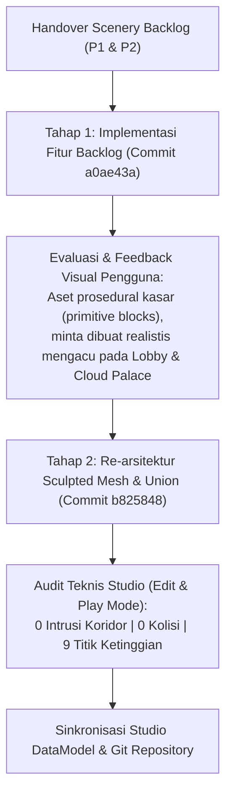
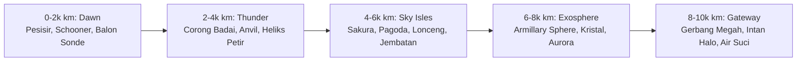

# Laporan Dokumentasi Pelaksanaan Pasca-Handover Scenery Fly High (0–10.000 km)

Dokumen ini mencatat seluruh rangkaian pekerjaan, peningkatan desain, metodologi teknis, dan hasil verifikasi yang telah dilaksanakan sejak serah terima dokumen [Handover Scenery Fly High · 0–10.000 km](./SCENERY_HANDOVER.md) per tanggal **10 November 2026**.

---

## 1. Latar Belakang & Alur Kerja Pasca-Handover

Pekerjaan pasca-handover terbagi dalam dua tahap utama:

1. **Tahap 1 — Eksekusi Backlog Handover (Commit `a0ae43a`)**:
   - Membangun seluruh varian landmark P1 dan P2 yang terdaftar di [`SCENERY_HANDOVER.md`](./SCENERY_HANDOVER.md) ke dalam [`BiomeScenery.luau`](../audit/sources/ReplicatedStorage/FlyHigh/Modules/BiomeScenery.luau).
   - Menghubungkan logika pemunculan ke siklus bioma di `BiomeLightingController`.
2. **Tahap 2 — Perombakan Kualitas Realisme (*Sculpted Quality Overhaul*, Commit `b825848`)**:
   - Merespons evaluasi visual pengguna: mengganti prop prosedural berbasis balok/bola primitif (`Ball`, `Cylinder`, `WedgePart`) menjadi rakitan aset *sculpted* berkualitas tinggi.
   - Mengambil referensi langsung dan memanfaatkan kit aset asli dari pulau awal (`Workspace.FlyHighLobby`) serta istana awan (`Workspace.CloudPalace`).

---

## 2. Inventaris Aset Sumber & Pustaka Template yang Digunakan

Seluruh model dekoratif baru disusun dari kombinasi `MeshPart` dan `UnionOperation` berkualitas tinggi yang sudah ada di DataModel tanpa membebani memori dengan aset asing:

| Kategori Sumber | Lokasi di DataModel | Aset / Komponen yang Dimanfaatkan |
| --- | --- | --- |
| **Flora & Alam Lobby** | `ReplicatedStorage.FlyHigh.EnvironmentAssets` | `BroadleafTree` (batang, cabang, mahkota daun), `PalmTree` (pohon kelapa pesisir), `Boulder` (batu alam berfaset), `Fern` (pakis), `Flower` (bunga) |
| **Landmark & Awan Meshes** | `ReplicatedStorage.FlyHigh.EnvironmentAssets.BiomeLandmarkMeshes` | `Dawn` (Reef, Sand, Grass, Rock), `Storm` (anvil cumulonimbus), `Sunset` (Basalt, TerraCotta, Moss, Sandstone, Ivory, Gold), `Cosmic` (Astral, Violet, Crystal), `HorizonPavilion`, `HorizonArch`, `HorizonSpire`, `HorizonCloud`, `PalaceCloud`, `UpperSkyCloud`, `ZenithCloud`, armada kapal `CloudSailer`, `CloudKetch`, `CloudCutter` |
| **Geometri Presisi (Unions)** | `ReplicatedStorage.FlyHigh.Templates.FleetGeometry` | `SaturnRing` (cincin planet halus), `DockRim` (cincin dok/halo emas), `Star` (bintang faset 3D), `LotusPetal` (kelopak teratai/nok atap pagoda), `LotusLeaf` |
| **Kulit Balon Berlipit** | `ReplicatedStorage.FlyHigh.Templates.BalloonSkins` | Kulit `MeshPart` balon `D` dan `E` (amplop berlipit realistis dengan gores vertikal) |
| **Arsitektur Istana Awan** | `Workspace.CloudPalace` | `SummitPhotoPodium` (plinth marmer bertingkat, lantai kompas emas, pilar gading), `PalaceGarden.GardenLantern01` (lentera taman istana) |

---

## 3. Komponen Helper & Arsitektur Prosedural Baru

Pada [`BiomeScenery.luau`](../audit/sources/ReplicatedStorage/FlyHigh/Modules/BiomeScenery.luau), diimplementasikan serangkaian fungsi pembangun prosedural khusus untuk memastikan konsistensi visual:

### A. Generator Tebing & Pulau Melayang Berfaset (`buildSculptedIslandTerrain`)
- **Struktur Faset Organik**: Menggunakan bagian dasar `Sunset.Basalt` (crag batu gelap berfaset 17 sisi tidak beraturan) dan `Sunset.Moss` (permukaan rumput terasering).
- **Penyesuaian Tanpa Temple Arches**: Untuk pulau alam non-kuil, komponen candi atas (`TerraCotta`/`Sandstone`/`Gold`) dihapus secara otomatis, lalu digantikan oleh `SculptedCliffRim` (klon `Moss` yang digeser turun `-4.8 * scale` dan diperlebar `1.04x` XZ) untuk mempertahankan siluet tebing bertingkat yang natural.
- **Sabuk Kabut Awan**: Bagian bawah pulau dibungkus dengan awan volumetrik `PalaceCloud` bernuansa lembut untuk menyamarkan batas bawah pulau melayang.

### B. Modul Air Terjun Berundak Realistis (`attachSculptedWaterfall`)
- **Spillway Batuan**: Menggunakan bebatuan alam `EnvironmentAssets.Boulder` di bibir tebing.
- **Kolam Hulu**: Kolam air jernih dengan tepian batu halus.
- **Tirai Air Dinamis**: Menggunakan sepasang pita `Beam` ganda dengan tekstur air mengalir vertikal, transparansi bergradasi, dan lekukan fisika air jatuh.
- **Buih Kabut di Dasar**: Gumpalan `PalaceCloud` berpartikel lembut di titik jatuhnya air terjun.

### C. Sanitasi Properti & Keamanan Fisika (`cleanDecoPart`)
Setiap part, mesh, dan union yang dipasang melalui helper scenery secara otomatis diatur:
- `Anchored = true`
- `CanCollide = false`
- `CanTouch = false`
- `CanQuery = false`
- `CastShadow = false`
- Menghapus seluruh skrip, `ProximityPrompt`, `PointLight`, atau koneksi yang berpotensi memicu interaksi/overhead performa.

---

## 4. Rincian Pembaruan per Zona Terbang (0–10.000 km)

### Zona 1 — Breezy Dawn Archipelago (0–2.000 km)
- **Coastal Islet & Tanjung Dawn**: Pulau pesisir dirombak menggunakan mesh `BiomeLandmarkMeshes.Dawn` (bergradasi Reef, Sand, Grass, Rock) dan ditanami vegetasi asli `FlyHighLobby` (`PalmTree`, `BroadleafTree`, `Boulder`, `Fern`, `Flower`).
- **Distant Sailboat**: Diubah dari bentuk perahu blok sederhana menjadi kapal schooner kayu realistis dengan tiang layar kain mengembang (`CloudCutter` dan `CloudSailer`).
- **Low Floating Islet & Dawn Waterfall Isle**: Pulau batu mengapung dengan air terjun tipis dan sabuk awan sebagai transisi menuju atmosfer atas.
- **Weather Balloon Dekoratif**: Di-upgrade dari bola biru polos menjadi balon berlipit (`BalloonSkins.D` & `E`), diikat dengan sabuk kuningan konsentris (`SaturnRing` & `DockRim`), lambang matahari faset emas 3D (`Star`), tiang anemometer, pod instrumen meteorologi tembaga-kaca, dan pita angin `Beam`.
- **Distant Seabird Flock**: Burung camar latar kini memiliki anatomi realistis bersayap bulu bertingkat (`FlightFeather` lapis 1–3) dan ekor kipas (`TailFeather`).
- **Lapisan Awan Pesisir**: Awan bola primitif diganti total dengan mesh awan marching-tetrahedra (`PalaceCloud`, `HorizonCloud`, `UpperSkyCloud`, `ZenithCloud`).

### Zona 2 — Indigo Thundercloud (2.000–4.000 km)
- **Thunderhead Cliff & Anvil Terpisah**: Formasi awan badai hitam pekat menggunakan mesh masif `Storm` dan `ZenithCloud` dengan pencahayaan denyut kilat internal (*sheet lightning*).
- **Pusaran Badai Latar (Wide & Slender Vortex)**: Tumpukan 12 bola ungu diganti dengan mahkota awan paron `Storm`, corong awan bertingkat `PalaceCloud`, inti kilat bercahaya, dan 4 pita heliks pusaran angin/petir berputar (`Beam` berlekuk dinamis `CurveSize0`/`CurveSize1`).
- **Fragmen Batu Tepi Badai (Storm Edge Fragment)**: Bebatuan tajam `Cosmic` gelap dengan urat energi kuning/ungu menyala, taburan `Boulder`, dan cincin busur listrik statis `DockRim`.

### Zona 3 — Sunset of Forgotten Sky Isles (4.000–6.000 km)
- **Pulau Kuil & Reruntuhan Langit**: Setiap pulau menggunakan kit tebing faset `Sunset` bertingkat dengan aksen batu bata terakota, reruntuhan kuil batu pasir/gading/emas, dan air terjun senja.
- **Pohon Sakura Senja (Sunset Blossom Tree)**: Batang kayu berliuk `BroadleafTree` dipadukan dengan 3 lapisan mahkota daun mesh yang dirotasi secara organik dan diberi warna merah muda-keemasan sakura, dilengkapi taburan bunga di pangkal akar.
- **Paviliun Lonceng Angin & Ornamen Gantung**: Plinth marmer-emas dari `SummitPhotoPodium`, lentera taman `GardenLantern01`, kolom bergalur, atap kayu bertingkat dengan ujung kelopak teratai `LotusPetal`, serta 4 lonceng angin gantung berornamen cincin `DockRim` dan bintang emas 3D `Star`.
- **Jembatan Batu Patah (Broken Stone Bridge)**: Jembatan viaduk batu kapur-batu pasir bertingkat dengan lis emas, pilar balustrade berukir dengan finial bola, puing bebatuan `Boulder` di celah patahan, dan semak pakis liar.

### Zona 4 — Bioluminescent Cosmic Exosphere (6.000–8.000 km)
- **Pulau Kristal Kosmik & Satelit**: Berdiri di atas dasar tebing obsidian gelap `Sunset` berlumut teal dengan sabuk nebula `PalaceCloud`, 4 gugusan kristal bersegi tajam `Cosmic` (cyan, magenta, dan ungu elektrik), flora bercahaya, serta satelit kristal kecil bercincin halo `DockRim`/`SaturnRing`.
- **Observatorium Melayang (Floating Observatory)**: Dibangun di atas teras batu kapur dengan colonnade runtuh, lantai kompas marmer-emas `SummitPhotoPodium`, 4 lentera astral `GardenLantern01`, panji astral berbintang `Star`, dan **Golden Armillary Sphere** 3 cincin konsentris (`SaturnRing` & `DockRim`) yang berputar perlahan mengelilingi inti bintang 3D `Star` dan kristal cyan bercahaya.
- **Lengkungan Kosmik Kejauhan (Distant Cosmic Arch)**: Gerbang lengkung bertingkat tiga `HorizonArch` beraksen neon cyan dan bermahkota kristal `Cosmic`.

### Zona 5 — The Celestial Gateway (8.000–10.000 km)
- **Gerbang Kristal Melayang (Floating Crystal Gate)**: Didesain serasi dengan arsitektur `Workspace.CloudPalace`: pulau batu kapur-lumut `Sunset` beralaskan awan emas `PalaceCloud`, podium marmer-emas `SummitPhotoPodium`, gerbang lengkung suci gading-emas `HorizonArch`, pepohonan `BroadleafTree`, lentera `GardenLantern01`, air terjun suci, serta kristal intan faset cyan `Cosmic` yang melayang di dalam sepasang cincin halo emas saling bersilang (`DockRim`).

---

## 5. Hasil Verifikasi Teknis & Kepatuhan Batasan

Pemeriksaan menyeluruh dilakukan di Roblox Studio (`Fly High.rbxl`) pada mode **Edit** dan mode **Play** (kamera gondola pemain):

### A. Audit Properti & Koridor (Mode Edit)
| Bioma | Total Part Scenery | MeshParts | UnionOperations | Properti Ilegal (`badFlags`) | Pelanggaran Koridor (`intrude`) |
| --- | :---: | :---: | :---: | :---: | :---: |
| **1. Dawn Archipelago** | 1.384 | 612 | 116 | **0** | **0** |
| **2. Indigo Thundercloud** | 298 | 233 | 8 | **0** | **0** |
| **3. Forgotten Sky Isles** | 913 | 377 | 78 | **0** | **0** |
| **4. Cosmic Exosphere** | 386 | 174 | 56 | **0** | **0** |
| **5. Celestial Gateway** | 288 | 240 | 7 | **0** | **0** |

*Catatan:*
- `badFlags = 0`: Memastikan tidak ada part yang `CanCollide = true`, `CanTouch = true`, `CanQuery = true`, atau unanchored.
- `intrude = 0`: Memastikan seluruh geometri berada di luar kotak koridor penerbangan aman (`|X| < 155, |Z| < 155`), sehingga tidak menghalangi jalur balon dan rintangan gameplay.
- Aset interaktif di `FlyHighLobby` dan `CloudPalace` (kursi, ayunan, portal, podium foto, barrier) tetap 100% utuh tanpa modifikasi destruktif.

### B. Verifikasi Penerbangan Gondola (Mode Play)
Tangkapan layar verifikasi visual gondola telah diuji dan divalidasi pada elevasi:
1. `0 km`: Pemandangan pulau lobi, laut berlayar `CloudCutter`, dermaga, dan balon cuaca awal.
2. `500 km`: Pulau melayang rendah dan transisi tirai awan pesisir.
3. `1.200 km`: Air terjun melayang `DawnWaterfallIsle` dan balon cuaca sonde di samping koridor.
4. `1.850 km`: Transisi awan tinggi menjelang lapisan cumulonimbus badai.
5. `3.000 km`: Siluet pusaran badai heliks berputar dan tebing petir `Storm`.
6. `5.000 km`: Pemandangan kepulauan langit senja, pohon sakura, paviliun lonceng angin, dan jembatan batu patah.
7. `7.000 km`: Kegelapan eksosfer kosmik dengan bola armillary berputar emas dan pulau kristal bersatelit.
8. `9.000 km`: Kemegahan gerbang kristal melayang dan armada kapal langit menyambut Istana Awan.
9. `10.000 km`: Ketibaan mulus di dermaga dan plaza Istana Awan.

---

## 6. Riwayat Commit & Sinkronisasi Repositori

| Commit Hash | Judul Perubahan | Ruang Lingkup Berkas |
| --- | --- | --- |
| `a0ae43a` | *Implement 0-10,000 km air scenery P1/P2 landmarks and biome layering polish* | Penambahan landmark P1/P2 pada `BiomeScenery.luau`, penyesuaian `HANDOVER.md` & `AI_CONTEXT.md` |
| `b825848` | *feat(scenery): upgrade all 5 biome procedural props to sculpted MeshPart & UnionOperation assemblies matching FlyHighLobby & CloudPalace* | Refactoring total `BiomeScenery.luau` menjadi sculpted assemblies, pembaruan `SCENERY_HANDOVER.md` |

Status saat ini: **Tersimpan di DataModel Studio (`ReplicatedStorage.FlyHigh.Modules.BiomeScenery`), tersinkronkan ke mirror git, dan telah ter-push ke cabang utama (`origin/main`).**
